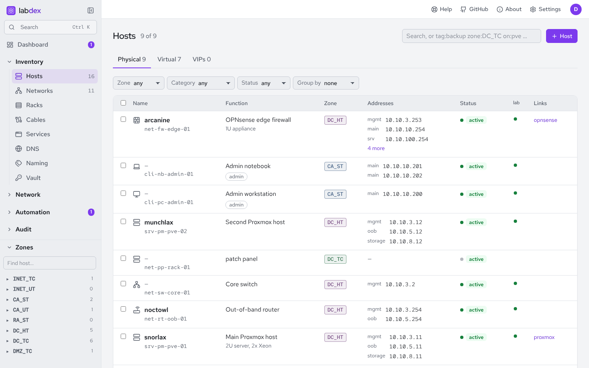

<h1>
  <picture>
    <source media="(prefers-color-scheme: dark)" srcset="docs/assets/labdex-logo-dark.svg">
    
  </picture>
</h1>

[](https://github.com/labdex-app/labdex/actions/workflows/ci.yml)
[](https://labdex-app.github.io/labdex/)
[](https://github.com/labdex-app/labdex/releases/latest)
[](https://github.com/labdex-app/labdex/pkgs/container/labdex)
[](LICENSE)

A small inventory for homelabs that treats **zones and names as first-class**.
You describe networks, hosts, interfaces and services once; labdex checks them
against your conventions and generates what the rest of the lab needs:
OPNsense aliases, DNS records (including SRV for service discovery), an Ansible
inventory, DHCP reservations and per-host login banners, and, through
integrations, keeps your firewall, DNS server and monitoring in step with it.

It's the lightweight middle ground between a spreadsheet and NetBox: one
container, SQLite, under 100 MB of RAM, and a YAML file you can keep in git.



**Docs:** <https://labdex-app.github.io/labdex/> (built from `docs/`) · **Plugins:** <https://github.com/labdex-app/labdex-plugins> ·
**Try it:** `docker run -p 8080:8080 -e LABDEX_DEMO=1 ghcr.io/labdex-app/labdex:1`

> [!WARNING]
> **Built with AI, for home labs only.** labdex was written largely with an AI coding
> assistant (Claude), directed and reviewed by a human. It has a test suite and was
> security-reviewed, but it has not had an independent audit and may well contain
> security problems. Run it in a home lab, on a trusted network, behind your own access
> controls. Don't expose it to the internet, and don't use it for production or
> business infrastructure. No warranty (see [LICENSE](LICENSE)).

## What it does

| | |
| --- | --- |
| **Inventory & IPAM** | Networks (VLAN, IPv4/IPv6 prefix, gateway, DHCP range), hosts with interfaces and services, what runs on which hypervisor. Next-free-address per network that skips the gateway, used addresses and the DHCP pool. |
| **Zones** | Every network (segment) and host belongs to a zone `<AREA>_<TRUST>`, e.g. `DC_TC` (datacenter, trusted-compliant) or `CA_UT` (campus, untrusted). Areas and trust levels are yours to create under Settings → Zones; nothing is predefined (an example set is one click away). |
| **Naming rules** | Functional hostnames `<category>-<type>-<role>-<nn>` (`srv-vm-dns-01`), picked from editable lists with the next free number filled in, plus any number of memorable *fun names* (`unown`, `resolver`), each a DNS CNAME; the first shows up in the prompt. |
| **Firewall aliases** | Generated per network, zone, area and host (`N4_ZONE_DC_TC_SRV`, `NG_ZONE_DC`, `H_ZONE_DC_TC_SRV_VM_DNS_01`), plus your own groups with any readable name whose members reference hosts, networks, zones or other aliases. On the firewall each alias gets an id of at most 32 characters (the name if it fits, else a stable shortened form, or one you set); the full name goes into the description. |
| **DNS** | `A`/`AAAA` per interface (`<host>.<network>.<domain>`), CNAMEs for short, fun and service names, `SRV`/`TXT` per service. As a zone file or JSON. |
| **Ansible** | Groups per category, zone, area, status and tag; host vars with addresses, aliases, a login banner (`labdex_motd`) and a zone-coloured prompt (`labdex_ps1`). |
| **Lint** | Placement (a device never sits above its own trust level), duplicate IPs and MACs, third octet vs. VLAN, alias length, unresolvable alias members, DNS name clashes. `labdex lint` exits non-zero on errors, so it can gate CI. |
| **Plugins** | Plugins with settings, actions and hooks, written in Python, Ansible or both. Official ones from the Marketplace: OPNsense alias sync, Technitium DNS sync, nmap discovery, Prometheus service discovery, login banners over Ansible, a YAML mirror, file exports and more; backups are built in. Changes to other systems are **planned first and applied after review**. |
| **Discovery** | nmap (TCP connect, no root), the OPNsense ARP table, Kea DHCP leases and DNS records show what's really there: undocumented services, unknown addresses, declared services that don't answer. One click adds a port to its host, or an unknown address to an existing host. Hosts get live up/down dots. |
| **Features (Ansible)** | A tree of features (`server` → `server.packages` → `server.packages.pve`) with nested variables and playbooks/roles. Hosts get features; variables merge root → leaf, then the host's own vars. The Ansible runner applies them with plan → apply. |
| **Per-host integrations** | Every integration applies to hosts by selector (`zone:DC_*`, `tag:admin`, …) and can be switched on/off and configured per host, with its own panel on the host page: DNS records that belong to the host, firewall rules that mention it, declared access without a pass rule, actions like *run a command*. |
| **Vault & backups** | A built-in KV vault (sealed start, versions, audited reveals) that plugins and Ansible point at; scheduled, encrypted backups to a folder, NFS or S3. |
| **Users, roles, history** | Local users, SSO headers and API tokens. Roles bound to zones, areas, networks, tags or name globs, plus per-object grants. Every change is recorded with a diff and can be reverted. |
| **Services page** | Every service with an http(s) link as a tile: the homelab dashboard falls out of the inventory. |

Nothing leaves labdex unless you add an integration for it, and integrations
that change another system show you a plan first.

## Quick start

```sh
git clone https://github.com/labdex-app/labdex && cd labdex
# set LABDEX_ADMIN_PASSWORD in docker-compose.yml (or leave it out and use the setup page)
docker compose up -d --build
docker compose exec labdex labdex import --yes /app/examples/homelab.yaml   # optional demo data
```

Open <http://127.0.0.1:8080> and sign in. With no users and no
`LABDEX_ADMIN_*` variables, the first visit asks you to create the administrator.

### Without Docker

```sh
cd frontend && npm ci && npm run build && cd ..   # builds the UI into backend/labdex/static
cd backend && pip install -e ".[server]"          # plus: apt install nmap; pip install ansible-core (optional)
labdex import --yes ../examples/homelab.yaml
labdex user create admin --admin
gunicorn --workers 1 --threads 16 -b 127.0.0.1:8080 "labdex:create_app()"
```

For UI development run `labdex run --debug` (port 5000) and `npm run dev` in
`frontend/`; Vite proxies `/api` to Flask.

## Configuration

| Variable | Default | |
| --- | --- | --- |
| `LABDEX_DATA` | `./data` | Database, `secret.key` and `plugins/` |
| `LABDEX_DB` | `sqlite:///$LABDEX_DATA/labdex.db` | SQLite (default) or `postgresql://user:pw@host/db` (see below) |
| `LABDEX_SECRET_KEY` | generated into `$LABDEX_DATA/secret.key` | Signs sessions and encrypts integration secrets. Losing it means re-entering secrets. |
| `LABDEX_ADMIN_USER`, `LABDEX_ADMIN_PASSWORD` | | Create this administrator on an empty database |
| `LABDEX_PLUGIN_DIR` | `$LABDEX_DATA/plugins` | Folder for your own plugins |
| `LABDEX_SSO_HEADER` | | e.g. `Remote-User`: trust this header from `LABDEX_TRUSTED_PROXIES` |
| `LABDEX_SSO_GROUPS_HEADER` | | e.g. `Remote-Groups`: comma-separated groups, matched to labdex groups by name |
| `LABDEX_SSO_AUTOCREATE` | `false` | Create users on their first SSO visit |
| `LABDEX_TRUSTED_PROXIES` | | Proxy addresses allowed to send the SSO headers |
| `LABDEX_COOKIE_SECURE` | `false` | Set `true` behind HTTPS |
| `LABDEX_SESSION_HOURS` | `12` | Session lifetime |
| `LABDEX_SCHEDULER` | `true` | Run scheduled integration actions |
| `LABDEX_WORKER` | `inline` | `inline`: the web server runs jobs. `external`: it only queues them for `labdex worker` |
| `LABDEX_DEMO` | `false` | Demo mode: a sample lab, reset every night (see below). Never on a real instance: it wipes the database |

Conventions (domain, alias length, hostname categories, DMZ area, the
octet-equals-VLAN check) are edited under Settings → Conventions.

### Database: SQLite or PostgreSQL

SQLite is the default and right for almost every homelab. PostgreSQL is
supported from 0.5 (install with `pip install ".[postgres]"`; the Docker image
has it, and `docker compose --profile postgres up -d` starts one):

```sh
labdex db copy --to postgresql://labdex:pw@db/labdex   # move an existing instance, then set LABDEX_DB and restart
labdex db current                                     # schema revision of the database
```

The schema is managed with Alembic and migrated on start; a 0.4 database is
adopted automatically.

### Demo mode

`LABDEX_DEMO=1` turns an instance into a public playground: on an empty database and
every night at 03:00 UTC it wipes everything and loads a sample lab (the one in
`examples/homelab.yaml`, with a zone policy), a `demo` / `demo-labdex` admin shown on
the sign-in page, and a pretend DNS server and monitor (the built-in *Demo lab*
plugin) so plans, approvals, host status and widgets have something to show. Nothing
talks to a network: only *Demo lab* and *File exports* can have instances, plugins
can't make HTTP requests or run Ansible, and installing plugins, repositories,
notification channels, secrets, restores and changes to users and passwords are off.

```sh
docker run -d -p 8080:8080 -e LABDEX_DEMO=1 ghcr.io/labdex-app/labdex:1
```

### Jobs and the worker

Integration actions run as jobs from a queue in the database. By default the web
server runs them itself (`LABDEX_WORKER=inline`), which is all a single container
needs. To keep long Ansible runs and scans out of the web process, or to run
several gunicorn workers on PostgreSQL, set `LABDEX_WORKER=external` on the web
server and start one or more workers with the same database and data folder:

```sh
labdex worker --slots 2      # runs queued jobs and the scheduler
```

`docker-compose.yml` has a commented `worker` service for this. A job whose
worker disappears (no heartbeat for 90 seconds) is marked failed; About shows
who runs jobs and how many wait.

## Getting around

The start page is the dashboard. The sidebar has the inventory pages (Hosts, Networks, Zones, Aliases, Services,
Features, Naming, Policy, Lint, History), the modules you've installed (Discovery
appears once something discovers, plus pages plugins add, such as *Firewall
access* or *Backups*), and a zone → segment → host tree with live dots. The
user menu has *About*: version, database, plugins and the changelog.

Hosts are named `<category>-<type>-<role>-<nn>`. Categories and types come from
the lists under Naming; the role is free text (the builder suggests the ones
you defined and those in use) and the number is the next free one. Fun names
can come from pools: four neutral ones ship with labdex, paste your own (and
tie it to a category or zone) under Naming → Fun name pools.

A host's home zone follows its primary interface's network unless you pin it;
each address keeps its network's zone. A VIP is a host of kind "VIP" with
member hosts. The DNS tab of a host lists every record it gets and takes extra
ones (an alias that follows the primary record, A/AAAA, TXT, SRV, MX).

DNS zones: a network's address records go to `<host>.<network>.<domain>` unless
the network names a zone of its own (`@` for the domain itself); a host's short
name, fun names and service names go to the domain unless the host names its main
zone. Services publish DNS-SD SRV/TXT records only when ticked. Technitium syncs
every zone labdex uses, each record into the closest zone on the server. Job output streams live over
Server-Sent Events, so a running Ansible play shows up line by line.

**Zone policy.** The Policy page is a matrix of which zone may reach which, on
which ports; anything not listed is denied. The OPNsense plugin turns it into pass
rules (one per zone pair and port entry, between the zones' aliases), adds rules for
services' *allow from* the matrix doesn't cover, and port forwards for public
services. Everything it writes is in the category `automation:labdex`; rules you made
are listed when the matrix doesn't explain them, never changed. With Technitium's
split horizon, a public service's name resolves to its internal address inside.

## Users, roles and history

- **Sign-in:** local passwords (10+ characters, throttled after 5 failures), SSO headers from a trusted proxy, or API tokens (`Authorization: Bearer ldx_…`, optionally read-only and expiring, stored hashed).
- **Permissions** are `<type>:<action>` with types `host`, `network`, `alias`, `integration`, `discovery`, `audit` and actions `view`, `edit`, `apply`, `admin`. Built-in roles: viewer, editor, operator, integration-admin, secret-keeper, admin.
- **Role bindings** give a user or group a role on a scope: `*`, `zone:DC_*`, `area:CA`, `network:srv`, `tag:admin`, `name:srv-vm-*`. A user with `editor` on `zone:CA_*` can't see or touch the datacenter.
- **Object grants** add exceptions for single objects, e.g. edit on `host:srv-vm-media-*` or apply on `integration:motd`.
- Moving an object needs edit rights on both its old and new place, so nobody can move a host out of reach of the people responsible for it.
- **History** records every create, update, delete, import, apply and sign-in with a field diff. Host, network and alias changes can be reverted; a revert is itself a recorded change.

## Plugins

Under **Plugins**, add an instance of a plugin (an integration), fill in its settings
and enable it. A plugin can have several instances, e.g. one per firewall.

| Plugin | Kind | What it does |
| --- | --- | --- |
| OPNsense | integration | Plan/apply sync of firewall aliases (tagged with the category `automation:labdex`; older `[labdex]` aliases are recognised); adds hosts to aliases you made by hand (and only ever removes what it added); Kea DHCPv4 reservations from the inventory's MAC/IP pairs (plan/apply) and leases into Discovery; per host: the rules that mention it and an access check of each service's *allow from*; rules from the zone matrix and port forwards for public services, both only in `automation:labdex`, with a drift report and per-zone status; imports the ARP table. |
| Technitium DNS | integration | Plan/apply sync of the inventory's records plus custom records (global and per host, with `{ip4}`/`{fqdn}` placeholders); per host: every record in the zone that belongs to it (by name, fun name, address or target), flagged in sync / missing / stale / unmanaged; records pointing at addresses that aren't in the inventory go into Discovery. Only touches records it created. Split horizon: public service names become internal zones. |
| Ansible runner | integration | Runs each host's features from a folder or git repository: playbooks then roles, ancestors first, `--check --diff` as the plan. Per host: apply its features, run a command, install packages. |
| Backup | module | Created on first start, daily. Database snapshot + inventory YAML as `.tar.gz`, encrypted with a passphrase (scrypt + AES-256-GCM), to a folder/NFS mount or S3 (AWS, MinIO, Garage), with retention. |
| nmap service discovery | integration | `nmap -sT` over chosen inventory networks; refuses targets outside the inventory. |
| Login banner & prompt | integration | Ansible playbook: `--check --diff` as the plan, the real run on apply. |
| Prometheus service discovery | module | `http_sd_configs` endpoints for node exporters and blackbox targets. |
| VictoriaMetrics / Prometheus | integration | Host status from `up` (down when every target of a host is down); CPU and memory widgets on host pages. |
| Beszel ¹ | integration | Host status, CPU, memory and disk from Beszel agents; adds hosts as systems (plan/apply) and installs the agent over Ansible. |
| Uptime Kuma ¹ | integration | A monitor per service with a link (plan/apply); host and service status read back. |
| Proxmox VE | integration | Read-only: imports VMs and containers as hosts (plan/apply), links existing ones, reports drift. |
| k3s / Kubernetes | integration | Read-only: nodes, roles, versions and readiness; drift against the cluster's feature. |
| Tailscale / Headscale | integration | Tailnet devices into Discovery; online state as host status. |
| UniFi Network ¹ | integration | Clients into Discovery; UniFi devices as host status. |
| Traefik | integration | Read-only: each HTTP router becomes a service (plan/apply) with its host name as link, on the backend's host or the Traefik host. |
| Docker | integration | Read-only: containers become hosts running on the Docker host, published ports and Traefik labels become services (plan/apply); container state as host status. |
| Routing discovery | integration | BGP neighbours and routes (OPNsense FRR, Cisco IOS-XE RESTCONF) compared with the inventory's networks. |
| Certificates | module | TLS certificate expiry of every https service (and endpoints you list), with warnings. |
| YAML mirror | module | Writes the inventory to a file after every change, optionally committing to git. |
| File exports | module | Download the OPNsense alias import, DNS zone, Ansible inventory, DHCP CSV, YAML. |

¹ Official plugins, maintained by the labdex project in their own repositories and installed
from the Marketplace (Plugins › Marketplace). Backups are part of labdex itself.

**Plan, then apply.** Actions with `mode: plan` compute the changes and stop.
You review the plan (each change with before/after) and apply or discard it.
A plan goes stale when the inventory changes in between; a newer plan replaces
an older one. **Hooks** re-plan automatically after inventory changes, and
**schedules** run actions every N minutes; both still wait for review.

**Applies to.** Integrations that work per host have selectors in the same
syntax as role scopes. On a host's page each such integration shows whether it
applies (and why), lets you force it on or off for that host, holds the host's
own settings (`host_settings` in the plugin), its actions (`scope: host`) and a
panel the plugin fills (`host_view`). Running a host action needs
`integration:apply` and `host:apply` on that host (the operator role has both).

**Secrets** (API keys, tokens, SSH keys) are encrypted at rest with a key
derived from `secret.key` (Fernet: AES + HMAC, so tampering is detected) and are
never sent back by the API. Shared ones live in the vault (sealed until an
administrator unseals it) and are picked *from the vault* in any integration:
rotating one updates every user.
Secrets are never in the YAML, and a database backup is useless for them without
`secret.key`.

### Features and the Ansible runner

```yaml
# in the inventory YAML (or under Features in the UI)
features:
  - {path: server, vars: {ntp: 10.10.3.253, pkgs: [vim, curl]}}
  - {path: server.packages, playbooks: [playbooks/packages.yml]}
  - {path: server.packages.pve, vars: {pkgs: [vim, curl, pve-headers]}}
  - {path: kube, vars: {version: v1.30.6}, roles: [k3s]}
  - {path: kube.cluster.oak, vars: {version: v1.31.2, vip: 10.10.128.10}}
hosts:
  - name: srv-vm-k3s-01
    features: [server.packages, kube.cluster.oak]
    vars: {k3s_role: server}
```

`srv-vm-k3s-01` gets `ntp`, `pkgs: [vim, curl]`, `version: v1.31.2`, `vip` and
`k3s_role`; *Apply features* runs `playbooks/packages.yml`, then the `k3s` role
(from `kube`), each limited to the hosts that have that feature. The same
variables and `feature_<path>` groups are in the Ansible inventory export, so
your own `ansible-playbook` runs see them too.

### Backups

The `backup` module exists from the first start and backs up daily to
`/data/backups`. Set a passphrase on its page (it warns until you do); for S3 a
passphrase is required. Keep `secret.key` somewhere else (password manager,
offline). To restore:

```sh
labdex backup check labdex-backup-20261023-020000.tar.gz.enc
labdex backup restore FILE --inventory-only       # just the inventory, server may run
labdex backup restore FILE                        # the whole database: stop the server first
```

Every backup carries a portable `database.json` (and on SQLite also the raw
`labdex.db`), so a backup restores into SQLite or PostgreSQL alike.

### Installing plugins

Under Settings → Plugins: upload a `.zip`, or add a signed repository and install
from it. labdex unpacks the archive, validates the manifest and checks
the signature **before any plugin code runs**, then shows you what you're
about to install:

| Trust | Means |
| --- | --- |
| built in | part of labdex (backups, the demo lab) |
| official | signed with the labdex project key (`labdex/keys/official/*.pub`) |
| community | signed with the key of a repository you added, or an author key you added under Signing keys |
| unsigned | no signature: installs only after you tick “I trust its author” |
| invalid | bad signature, unknown key or files changed after signing: never loaded, not even from disk |

The **official repository** ([labdex-plugins](https://github.com/labdex-app/labdex-plugins),
signed with the project key) is there out of the box and is where every official plugin
comes from (since 1.24.1 none ships with labdex); remove it and it stays removed. `LABDEX_OFFICIAL_INDEX`
points elsewhere, or is empty to have none.

A repository is a signed `index.json` next to the plugin archives, on any web
server. Its key signs the index and every plugin in it. When you add one, labdex
shows its name and key id; compare the key id with the one the publisher gives you.
The key is pinned from then on: a re-signed or changed index, or a plugin signed
with another key, is refused.

For publishers: `labdex plugin keygen my.pem`, put each plugin in its own folder,
then `labdex plugin repo ./plugins ./public --key my.pem --name "My plugins"` signs
them, zips them and writes `public/index.json`. Publish `public/`. (Single plugins:
`labdex plugin sign` and `labdex plugin pack`; share `my.pem.pub` so people can trust
the key under Signing keys.)

### Writing a plugin

Drop a folder into `/data/plugins/<id>/` and restart:

```yaml
# plugin.yaml
id: pihole
name: Pi-hole
kind: integration            # or module
version: "0.1"
labdex: ">=1.0,<2"           # the labdex versions it works with (PEP 440 range)
description: Local DNS records in Pi-hole
settings:
  - {key: url, label: URL, type: string, required: true}
  - {key: password, type: secret, required: true}
  - {key: networks, type: networks}          # string secret bool int select text list networks table yaml
host_settings:                               # per host, shown on the host page
  - {key: records, type: table, columns: [{key: name}, {key: value, required: true}]}
host_view: true                              # plugin.host_view(host) fills a panel on the host page
tags: [dns]                                  # for search
provides: [discovery]                        # shows the Discovery page (or: features)
pages:                                       # sidebar pages, filled by page_<id>(args)
  - {id: overview, label: Pi-hole}
actions:
  - {id: test, label: Test connection, mode: run}
  - {id: sync, label: Sync records, mode: plan, schedulable: true}
  - {id: hosts_file, label: hosts file, mode: export}
  - {id: deploy, mode: plan, ansible: playbooks/deploy.yml}   # Ansible: check+diff, then apply
  - {id: restart, mode: run, scope: host, danger: true,       # per host, with a form for parameters
     params: [{key: service, type: string, required: true}]}
hooks:
  - {events: ["host.*", "network.*"], action: sync}
endpoints:
  - {id: targets, label: JSON for something to poll}
```

```python
# plugin.py
from labdex.plugins.base import Change, ExportFile, Plugin as Base, PluginError

class Plugin(Base):
    def run_test(self, params):
        self.ctx.http(self.settings["url"]).get("api/info")
        return {"message": "ok"}

    def plan_sync(self, params):           # return a list of Change
        want = {r["fqdn"]: r for r in self.ctx.inventory.dns_records() if r["type"] == "A"}
        return [Change("create", "record", fqdn, f"A {r['value']}", after=r) for fqdn, r in want.items()]

    def apply_sync(self, changes, params):  # called with the reviewed plan
        for c in changes:
            self.log(f"creating {c.name}")
        return {"applied": len(changes)}

    def export_hosts_file(self, params):
        return ExportFile("hosts.txt", "text/plain", "\n".join(...))

    def endpoint_targets(self, params):
        return [...]

    def host_view(self, host):                # host["module_settings"] = its host settings
        return {"summary": [{"label": "records", "value": 3, "tone": "ok"}],
                "sections": [{"title": "Records", "type": "table", "columns": [{"key": "name", "label": "Name"}],
                              "rows": [{"name": "nas", "_tone": "warn"}]}]}

    def run_restart(self, params):            # params["host"] is set for scope: host
        host = self.ctx.host(params["host"])
        ...
```

**Compatibility.** `labdex:` is the range of labdex versions the plugin works with,
e.g. `">=1.0"` or `">=1.0,<2"`. labdex refuses to install or load a plugin outside its
range and says why; a plugin without one is assumed to work. From 1.0 on, the plugin
API (manifest keys, `Plugin`, `Context`, `InventoryView`, `Change`, `ExportFile`,
widget kinds) only grows within a major version: `>=1.0,<2` stays true.

`self.ctx.hosts()` returns the hosts the integration applies to, each with
`module_settings`; `self.ctx.state` / `set_state()` keep small plugin state.

`self.ctx.inventory` gives hosts, networks, aliases, DNS records, the Ansible
inventory and the YAML; `self.ctx.http(url)` is a requests session with the
TLS settings applied; `self.ctx.ansible(playbook, extravars=…)` runs a playbook
against the inventory with settings as `labdex_settings`;
`self.ctx.notify(event, title, body, link)` sends a notification to the channels
that subscribed to it (`host.down` and `host.up` keep their names, anything else
becomes `plugin.<id>.<event>`).

**Widgets** show on the dashboard or a host's overview. Declare them and return
data in one of labdex's kinds; labdex draws them (no plugin code in the browser),
caches them for `refresh` seconds and gives each call a few seconds:

```yaml
widgets:
  - {id: queries, label: DNS queries, where: dashboard, size: wide, refresh: 60}
  - {id: load, label: Load, where: host}
```

```python
    def widget_queries(self, host):          # host is None on the dashboard
        return {"kind": "sparkline", "points": [...], "unit": "q/s", "sub": "last hour"}
    def widget_load(self, host):
        return {"kind": "status", "items": [{"label": host["name"], "state": "up", "detail": "load 0.3"}]}
```

Kinds: `stat` (value, unit, tone ok/warn/err), `status` (items with up/down/warn/
unknown), `list` (label, value, tone), `table` (columns, rows), `sparkline`
(points, value, unit, min, max). Each can have `sub` and a `link` inside labdex or
to http(s). Plugin code runs inside
labdex with its permissions, so only install plugins you trust.

## CLI

```sh
labdex import inventory.yaml       # replace the inventory (asks first; --yes to skip)
labdex export -o inventory.yaml    # write the inventory
labdex lint                        # exit 1 on errors; --warnings-as-errors for strict CI
labdex user create NAME [--admin]  # labdex user password NAME
labdex token create USER NAME [--read-only] [--days 90]
labdex plugins                     # plugins and integrations
labdex action fw-main sync_aliases [--apply]
labdex backup create -o FILE | check FILE | restore FILE [--inventory-only]
labdex db current | upgrade | copy --to URL      # schema migrations, move to another database
```

Upgrading from an older version needs nothing: the schema is migrated on start.

## API

JSON under `/api`; sign in with the session cookie (browser; writes also need
the header `X-Requested-With: labdex`) or a bearer token. Validation errors come
back as `422` with a list of `{field, message}`; missing permissions as `403`;
objects outside your scope as `404`.

Every successful `GET` carries a weak `ETag`; send it back as `If-None-Match`
and an unchanged answer is an empty `304`. Lists page with a cursor:
`/api/history` and `/api/jobs` take `limit` and `before=<id>` and return the
next cursor in `X-Next-Before`. `/api/hosts` takes `fields=name,zone,…`, `q=`,
`zone=`, `status=`, `sort=name|-zone|ip|…`, `limit=` and `offset=`, with the
total in `X-Total-Count`.

| Method | Path | |
| --- | --- | --- |
| GET | `/api/meta` | Zones, areas, settings, counts, your permissions |
| GET, POST · GET, PUT, DELETE | `/api/hosts` · `/api/hosts/<name>` | Hosts (filtered to what you may see; `can_edit` per row) |
| GET, POST · GET, PUT, DELETE | `/api/networks` · `/api/networks/<name>` | Networks; `/next` gives the next free address |
| GET, POST, PUT, DELETE | `/api/aliases[/<name>]` | Aliases, generated and custom |
| GET | `/api/services`, `/api/lint` | Services, convention checks |
| GET · GET · POST | `/api/history` · `/api/history/<id>` · `/api/history/<id>/revert` | Audit log with diffs |
| GET | `/api/discovery/{summary,services,missing,unknown-hosts}` | Discovery |
| GET, POST · GET, PUT, DELETE | `/api/integrations` · `/api/integrations/<name>` | Integration instances |
| POST | `/api/integrations/<name>/actions/<action>` | Start a job (`202`) |
| GET | `/api/integrations/<name>/export/<action>`, `/endpoints/<id>` | Exports, plugin endpoints |
| GET · POST | `/api/jobs[/<id>]` · `/api/jobs/<id>/{apply,discard}` | Jobs and plans |
| GET · PUT | `/api/hosts/<name>/modules` · `/api/hosts/<name>/modules/<integration>` | Integrations for a host: on/off, host settings |
| GET · POST | `…/modules/<integration>/view` · `…/actions/<action>` | Host panel, host actions |
| GET, POST · PUT, DELETE | `/api/features` · `/api/features/<path>` | Feature tree |
| GET · POST, PUT, DELETE | `/api/zones` · `/api/zones/{areas,trust}[/<code>]` | Areas and trust levels; `POST /api/zones/example` |
| GET · GET · POST, PUT, DELETE | `/api/naming` · `/api/naming/next?category=&type=&role=` · `/api/naming/<kind>[/<code>]` | Hostname parts, next free name |
| GET, POST · PUT, DELETE · GET | `/api/naming/pools` · `/api/naming/pools/<name>` · `/api/naming/fun-suggest?category=&zone=&pool=` | Fun name pools, unused suggestions |
| GET · POST | `/api/about` · `/api/about/update-check` | Version, schema, database, plugins, changelog; check for a release now |
| GET | `/api/nav` | Sidebar: zone tree with live status, module pages |
| GET | `/api/events[?job=<id>]` | Server-Sent Events: plan count, `revision` on every change, job status and output |
| POST · POST · DELETE | `/api/plugins/upload` · `/api/plugins/stage/<token>/confirm` · `/api/plugins/<id>` | Install, confirm, remove |
| GET · POST | `/api/plugin-repos` (`/preview`) · `/api/marketplace` · `/api/marketplace/install` | Signed repositories and their plugins |
| POST · DELETE | `/api/discovery/addresses/assign` · `/api/discovery/addresses/<ip>` | Add a seen address to a host; forget it |
| GET · PUT, DELETE | `/api/secrets` · `/api/secrets/<name>` | Older API for vault entries under `global/` (field `value`) |
| | `/api/auth/*`, `/api/admin/*` | Sign-in, tokens; users, groups, roles, bindings, grants, backup/restore |

## Security notes

- Put it behind your reverse proxy over HTTPS (`LABDEX_COOKIE_SECURE=true`). SSO headers are only trusted from `LABDEX_TRUSTED_PROXIES`.
- Session cookies are HttpOnly and SameSite=Strict; writes additionally need a custom header, so other sites can't post forms to labdex. Strict CSP, no framing.
- The container runs as an unprivileged user with a read-only root filesystem; only `/data` is writable.
- Integrations use their own least-privilege API users: an OPNsense user limited to the pages for the actions you use, a Technitium token for the zones labdex manages.
- Sign-in is throttled per client (the real client behind a trusted proxy) and per user; event streams end when the session or token does. See `docs/operate/security-review.md` for the 1.0 review.
- Releases are signed with cosign (keyless) and come with SBOMs; see `docs/operate/security.md` for how to verify.
- Back up `/data` including `secret.key`; without it, stored secrets can't be decrypted.
- Plugin code runs inside labdex. Prefer signed plugins; an unsigned one needs an administrator's explicit OK, and a plugin whose files no longer match its signature isn't loaded.
- The official signing key's private half is not in this repository. If you fork labdex, put your own public key into `labdex/keys/official/`.

## Development

```sh
cd backend && pip install -e ".[server,postgres,test]" ruff
pytest -q                                                    # SQLite
LABDEX_TEST_DATABASE_URL=postgresql://u@localhost/t pytest -q   # the same suite on PostgreSQL (wiped per test)
LABDEX_PERF=1 pytest -q -s tests/test_perf.py                # performance budget on 1000 generated hosts
LABDEX_E2E=1 pytest -q tests/e2e                             # browser tests (npm run build and playwright install chromium first)
python tools/big_inventory.py 1000 > big.yaml                # a large demo inventory
```

GitHub Actions runs it on pull requests (`ci.yml`: what a change can affect, including a docs
build and the upgrade gate, a 0.5 database started on the current release,
`tests/test_upgrade_gate.py`), and ruff and eslint on every push (`lint.yml`).
Publishing a GitHub release tagged `v<version>` publishes signed multi-arch images (amd64, arm64) to `ghcr.io/<owner>/labdex`
and a GitHub release with signed archives, wheel and SBOMs (`release.yml`). `docs.yml`
publishes the docs, one version per release, to GitHub Pages; the official plugin
repository is its own project ([labdex-plugins](https://github.com/labdex-app/labdex-plugins)).

The OPNsense and Technitium plugins are checked against OPNsense 26.1 (Kea
inside OPNsense) and Technitium DNS Server 15.6.2; `tests/test_contracts.py`
pins the API details that matter.

## Roadmap

1.0 is out: the plugin API, the REST API, the YAML and the backup format stay
compatible within 1.x. 1.1 added discovery from Traefik and Docker. See `CHANGELOG.md` for what
each release brought.

## License

labdex is **free and open source software** under the [GNU Affero General Public License
v3.0](LICENSE) (AGPL-3.0), with a [plugin exception](NOTICE):

- **Use it for free**, for anything, at home, at school or at work.
- **Change it and share it**, as long as your version stays under the AGPL, keeps the
  credit to the original (the [NOTICE](NOTICE) file), and comes with its source.
- **Running a changed labdex for others** (a hosted service, say) counts as sharing it: you
  have to offer them its source too. Nobody can turn labdex into a closed product.
- **Plugins** may use any licence they like. The official plugins in the `labdex-plugin-*`
  repositories are AGPL-3.0 too.

Versions up to and including 1.23.1 were released under the MIT licence; copies of those
keep it.
