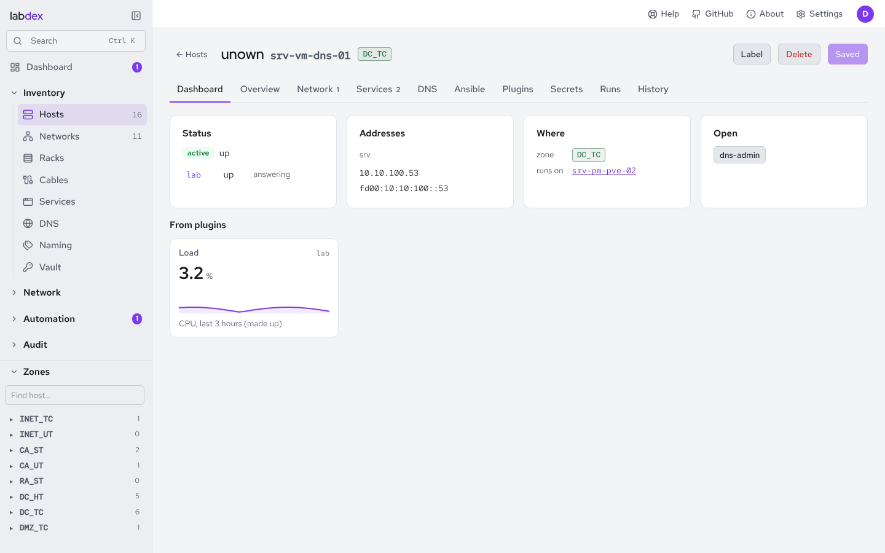
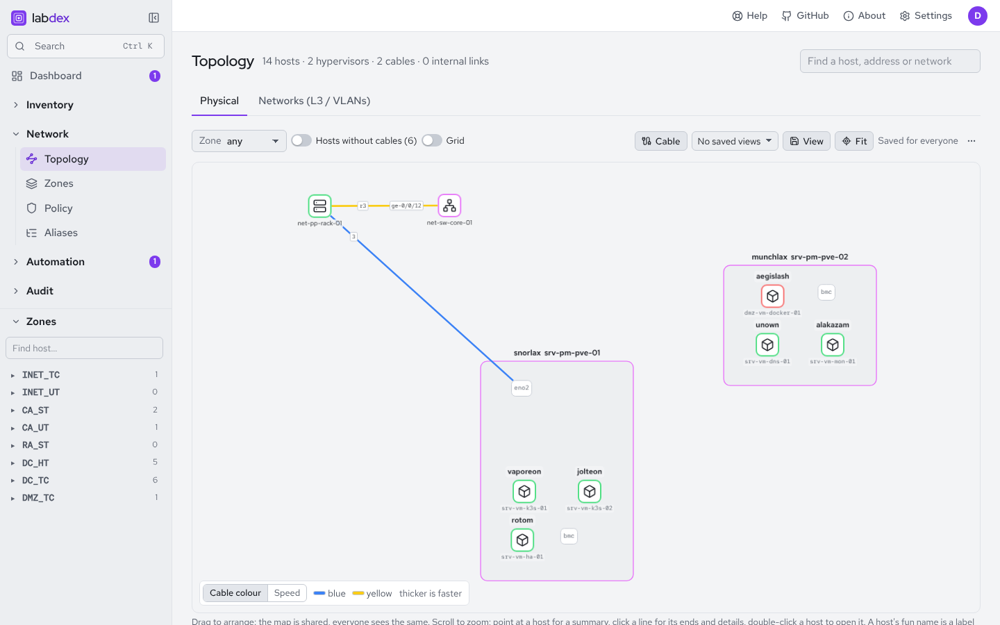
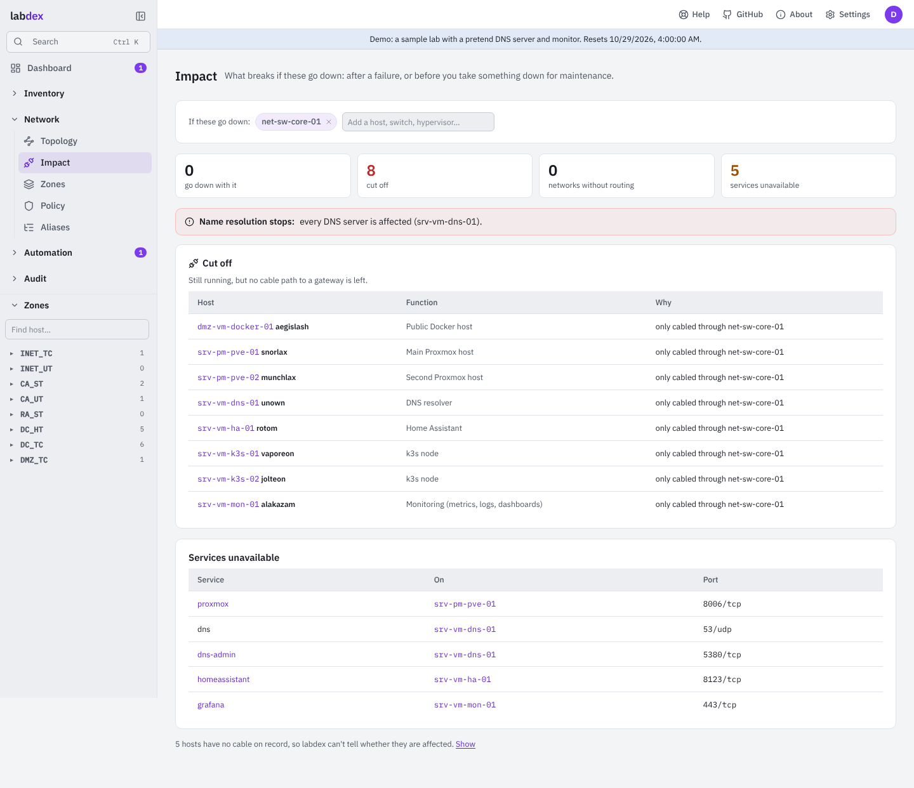
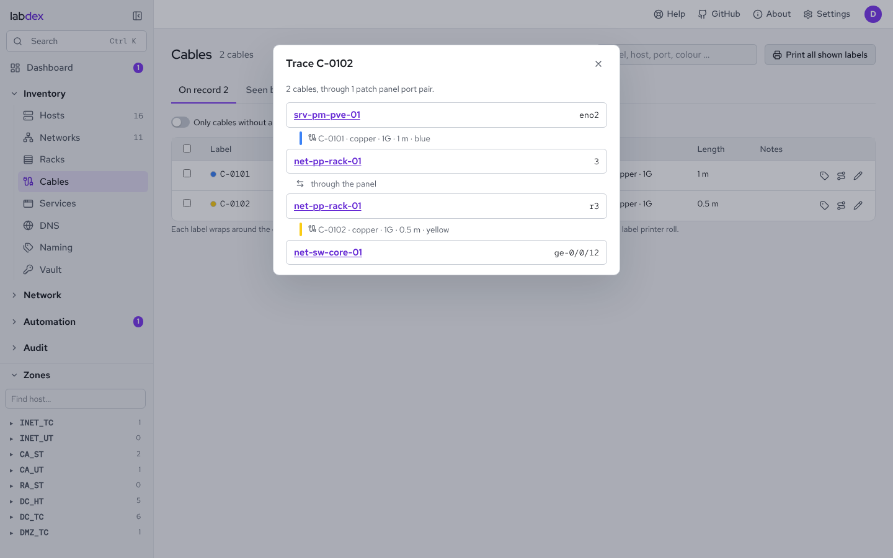
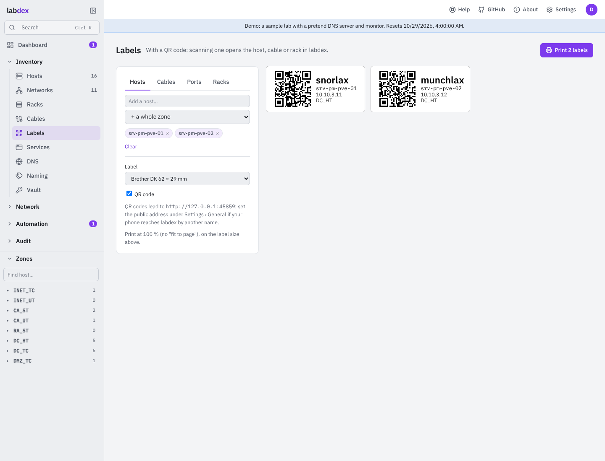
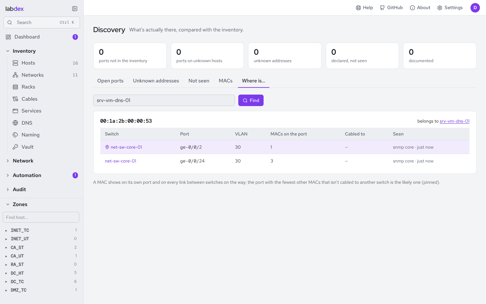

# Hosts, networks, services

## Networks

A network has a name, VLAN, zone, IPv4 and IPv6 prefixes (several are fine), a
gateway and a DHCP range. labdex suggests the next free address (skipping the gateway
and the DHCP pool), shows what's used, and lint checks that the third octet matches the
VLAN if you want that convention. A network can name its own DNS zone.

## Hosts

A host has a functional name, fun names, a kind (machine, VM, container, VIP), a
status (active, planned, offline, legacy), the hypervisor it runs on, tags,
features, variables, a vendor, model and icon, and interfaces. Each interface has a name
and type, sits in a network with IPv4/IPv6 addresses (plus secondary addresses) and a
MAC; one is primary. An interface can sit on another one (a VLAN on a bond, a VM's NIC on
its hypervisor's bridge `srv-pm-pve-01:vmbr0`). **Cables** connect a port on one host to
a port on another (switch ports needn't be interfaces); a port holds one cable. An
**internal** link joins a guest's interface to a bridge of the host it runs on (or two
guests of one host); a bridge holds as many as you like. A VIP is a host whose members
are other hosts; VIPs have their own tab on the Hosts page, next to **Physical** and **Virtual** (a host
that runs on another one, or a VM or container by the type in its name).

**Addresses per family.** An interface's addresses are edited like a network's prefixes:
under IPv4 the main address and any more; under IPv6 an interface ID (used in every IPv6
prefix of the network) or an explicit address, and any more. The main ones are in DNS
and used for monitoring; the others count for firewall aliases, IPAM and Discovery.

**A host's dashboard.** An existing host opens on **Dashboard**: its status and what
monitors say, its addresses, where it sits (zone, hypervisor, guests, cables), links to
its services, and what plugins show for it. The form is under **Overview**.

**Addresses that last.** Hosts, networks and zones have a short id that never changes
(`/hosts/7k2m9x4qa1`): a link keeps working after a rename. Links by name
(`/hosts/srv-vm-dns-01`) still work and move on to the id. A zone's page
(`/zones/<id>`, from the code on the Zones page) lists its networks, the hosts at home
there and what the zone policy lets in and out.

## Racks

Inventory › Racks draws every rack as an elevation, front and rear side by side, unit 1 at
the bottom, grouped by site (a room, a building). Click a free unit to put a host there
(its height comes from the host's **Size**, in units (U, HE), set on its Overview), or a
panel: a patch panel, cable management, a blank panel, a shelf, a PDU, with a label and a
description ("24 × Cat6 to the office"). Each sits on the front, the rear or through the
full depth. A host's ⋯ moves it or takes it out; a panel opens its settings. Two devices can share a unit on
opposite sides; a full-depth one takes both. A host's Overview has the same fields, and
its Dashboard says where it sits. People who edit hosts change racks; everyone else
sees them, and only the hosts they may see.

## Topology

Network › Topology draws the lab two ways.

**Physical.** A host that others run on is a **box** with its guests inside, and its own
interfaces as small ports, joined the way they're stacked (vmbr0 on bond0 on eno1 and
eno2). Cables are solid lines in the cable's own colour (or coloured by speed: switch it on
the legend) and thicker when faster, with the port names as small tags near their ends; a cable between two ports of one host is a loop. Internal links are
dashed lines from a guest to the bridge it sits on. A guest whose interface doesn't say
what it sits on is joined to its hypervisor's bridge in the same network, drawn fainter:
a guess until you set it. VIPs aren't drawn here (they're addresses, not boxes with
cables).

**Networks (L3 / VLANs).** Networks are nodes and every host is joined to the networks it
has an address in; hosts in several networks are diamonds. A VIP is joined to the hosts
that hold it. The chips above the map hide and show single networks (kept in your browser).

Hosts show their hostname below them and their fun name above, in their zone's colour or
a colour of their own (Overview › Colour on the map). The fun name is a label of its own:
drag it wherever it reads best and it stays there, following the host. Point at a host for a summary; click it for its
links; click a line for its two ends and, for a cable, its medium, speed and notes, which
people who edit hosts can change or remove right there. **Cable** draws a new one: click
both ends (the same host twice for a cable between two of its ports).

The arrangement is shared: drag things where they belong and everyone sees the same map
(people who edit hosts move it; Arrange again lays it out anew). **Grid** shows a dot grid
and snaps what you drop to it.

**Saved views** keep a way of looking at it: the picture, the zone, hidden networks, the
options and where you've zoomed to ("Rack room", "Kube networks"). Everyone who sees the
topology can open them from the list or by link (`/topology?v=<id>`); people who edit
hosts save, update and delete them. **PNG** and **SVG** download the whole picture.

## Impact

Network › **Impact** answers *what breaks if this goes down?*, after a failure or before you
take something down for maintenance. Pick one or more hosts (a host's **Impact** button, or
*What breaks if X goes down?* in the search box). labdex lists:

- the hosts that **go down with it**: what runs on it, VMs and containers, recursively;
- the hosts that are **cut off**: still running, but every cable path to their network's
  gateway runs through something that's down (patch panels are followed port by port, so two
  runs through one panel stay apart);
- **networks without routing**, **VIPs** that lose some or all members, **services** that become
  unavailable and whether **DNS** stops or just has fewer servers.

Each affected host says why ("runs on srv-pm-pve-01", "only cabled through net-sw-core-01").
Nothing is guessed: it all comes from runs-on, cables, gateways, VIPs and services in the
inventory. Hosts with no cable on record are listed apart, as labdex can't tell. Set the
networks' gateways and the hosts that hold them to get *cut off* answers.

## Cables

Inventory › **Cables** lists every cable you may see both ends of: its **label** (what's
printed on it), both ends, medium, speed, **length** in metres and jacket **colour**.
*Next free* continues the labels the lab already uses (C-0042 → C-0043); a label belongs
to one cable only. **Print labels** opens [Labels](#labels) with two labels per cable, one for each
end, each naming this end and the other one (the ticked cables, or all shown). Label,
length and colour are also on the cable dialogs of a host and of the topology.

**Seen by switches.** Switches that tell labdex their neighbours (the *SNMP neighbours*
plugin reading LLDP and CDP, or *UniFi* signed in with a local account) feed the second tab
of Cables. *New* lists cables between two known hosts that aren't on record: tick and
*Add* them (each one goes through the host's normal checks and into History, a port the
host doesn't have yet is added) or *Ignore* them for good. *Different from the record* lists
ports where a switch sees something else than the cable on record: keep the record, or use
what's seen (the old cable goes). *Neighbours labdex doesn't know* can become hosts with a
click, prefilled with the address and MAC. A cable both ends report shows once; port
names match whatever their case.

**Patch panels.** A patch panel is a host whose front ports pass straight through to its rear
ports: on an interface, *Passes through to* names the port on the other side (set on one,
both get it). *Several* adds a whole panel at once: tick *Patch panel* and every port gets a
rear port (`1` ↔ `r1`, `2` ↔ `r2` …). **Trace** (on a host's port, a cable on the Cables page
or a cable on the topology) follows a cable end to end through any number of panels:
server `eth0` → panel A `1` … `r1` → panel B `r3` … `3` → switch `ge-0/0/5`, with each
cable's label, colour and length.

A host with four ports or more shows a **front panel** on its Dashboard and Network tab:
its ports in order, odd ones on top, RJ45 and SFP-style cages apart, a cabled one in its
speed's colour. Point at a port for where it goes; click it for its cable (or a new one).

## Labels

Inventory › **Labels** prints labels with a **QR code**: scan one with a phone and labdex opens
that host, cable or rack. Choose *Hosts*, *Cables*, *Ports* (every cabled port of a switch or
patch panel, naming the far end) or *Racks*, pick what to print, then the label size.

- **Roll printers** (Brother DK 62 × 29 and 54 × 17, Dymo 99012 and 11352) print one label
  per page at the label's own size. A **cable flag** (72 × 12 mm, for 12 mm tape) wraps around
  a cable: the same text on both halves.
- **A4 sheets** (Avery L7651, 65 per page, and 3474, 24 per page) place the labels on the
  grid. *Start at label* skips the ones you've already used on a part-used sheet.
- Print at 100 % (not "fit to page"). On labels shorter than 14 mm the QR code is left out:
  it would be too small to scan.
- The code leads to the address under Settings › General › *Public address*, or to the address
  you're using now. Set it if your phone reaches labdex by another name than your computer does.

Every host also has a **Label** button, and Cables prints its selection here.

## Interfaces

The Network tab lists **physical** interfaces (ethernet and Wi-Fi ports) first and
**virtual** ones (bonds, bridges, VLANs, tunnels, loopbacks) below, each under what it
sits on. A physical port has a connector (RJ45, SFP, SFP+, SFP28, QSFP+, QSFP28 …) and a
speed; picking a connector offers its usual speed. **Several** adds many at once from a
pattern: `eth[0-3]`, `1/0/[1-48]`, `swp[1-4]s[0-3]` (every combination), `Gi1/0/[01-24]`
(keeps the leading zero), with one type, connector, speed and network for all; names the
host has already are skipped.

## Address map

A network's **Address map** tab shows every address of its IPv4 prefix as a grid, a /24
at a time: in use, gateway, DHCP pool, **seen** (Discovery saw something there that no host
has), **conflict** (two hosts have it, or Discovery saw a different MAC than the inventory
has), free. Click a free address to make a host with it; click a seen one to add it as a
host with what Discovery knows.

## Services

A service has a name, port and protocol, a description, where it listens (every
address, the primary interface, one network or one address), a link (`https://…`,
by name or address; the DNS name may be relative to the host's zone, `grafana`, or a
full name ending in a dot, `grafana.example.com.`, which gets a record only inside a
zone labdex writes), DNS-SD records if you tick them, and **allow from**: the zones,
areas, networks or aliases that may reach it. That list drives the firewall access
check and, with the OPNsense plugin, rules of its own.

A service can be **public**: it then gets a public name and a WAN port, a port forward
on OPNsense and a split-horizon zone on Technitium ([Zone policy](policy.md)).

The Services page is a launcher: every service with a link as a card, grouped by zone,
with its status from a monitor or Discovery.

## Discovery

nmap scans, the OPNsense ARP table, Kea leases, DNS records, Tailscale, UniFi
clients and Proxmox guests the inventory doesn't have feed Discovery: unknown addresses, undocumented open ports, declared services
that don't answer. One click adds a port to its host or an address to an existing
host.

**Where is …?** (Discovery's last tab, or type a MAC or an address in the search with
Ctrl K) finds the switch port behind any MAC, IP address or host: from the switches'
forwarding tables, which the *SNMP neighbours* plugin reads (BRIDGE-MIB and Q-BRIDGE-MIB,
per VLAN) and *UniFi* reports for its clients (wired: the switch port; Wi-Fi: the access
point). A MAC shows on its own port and on every link between switches on the way; labdex
pins the likely one (the fewest other MACs, not cabled to another switch). A host's Network
tab shows that port next to each interface with a MAC and no cable on record.

A service is *answering* when a scan saw its port open on an address it listens on, and
*not answering* only when a scan checked that port and found it closed. nmap checks the
ports of every declared TCP service on its host, also ports outside its own list (a
service on 32400 is looked at even with the top 200 ports), so a service is never
reported down just because nobody looked; until then it shows *not scanned*.

## Lint

Placement, duplicate IPs and MACs, octet vs. VLAN, alias length, unresolvable alias
members, DNS name clashes, missing secrets, public services outside a DMZ and more.
`labdex lint` exits non-zero on errors, so it can gate CI on your inventory YAML.
