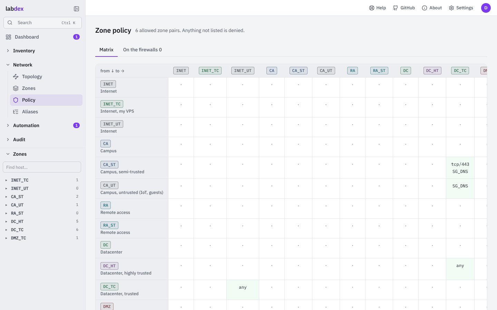

# Zone policy and the firewall

## The matrix

The Policy page is a matrix of zones: rows are where traffic comes from, columns where
it goes. A cell holds ports and a reason:

- `any`, a port alias (`SG_WEB`), or `tcp/443`, `udp/53`, `tcp/8000-8100`.
- **No cell means no access**: anything not listed is denied.

Everyone can read the matrix; admins edit it. Changes are recorded in History, emit
`policy.updated`, and are part of the YAML (`zone_policy`).

## Rules on OPNsense

The OPNsense plugin's **Sync policy rules** turns the matrix into pass rules:

- one rule per cell and port entry, on the source zone's interfaces, from the source
  zone's alias to the destination zone's alias;
- one rule per service *allow from* that the matrix doesn't already cover;
- one rule per host-wide rule and port (a host's own *allow from* / *allow to*);
- all of them in the category `automation:labdex`, keyed in the description
  (`[zone:CA_ST>DC_TC:SG_WEB]`).

Your own rules are never changed. **Rules no policy explains** lists your pass rules
between zones the matrix doesn't allow, so you can move them into the matrix or remove
them.

## Public services

Tick *public* on a service, give it a public name and a WAN port. **Sync port
forwards** plans a destination NAT rule per public service (WAN address and port to
the host's address and the service's port), also in `automation:labdex`. Lint warns
when a public service lives outside a DMZ zone.

## When is a zone done?

Network › Policy › **On the firewalls** shows every firewall that enforces the matrix,
with **Sync policy rules** next to each (a plan you review). Each has a **Zones** table: per zone, the labdex rules
and the other pass rules on its interfaces, and gaps in the access check (declared
access without a pass rule). A zone whose inbound pass rules all come from labdex and
which has no gaps is *managed by labdex*. **Check access** logs those zones too.
